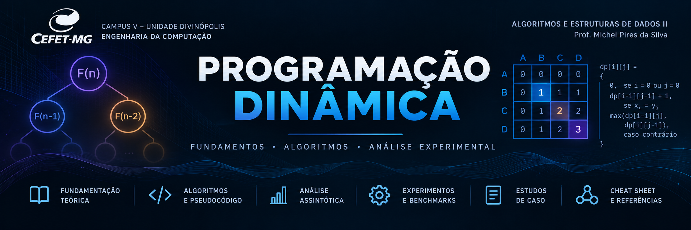
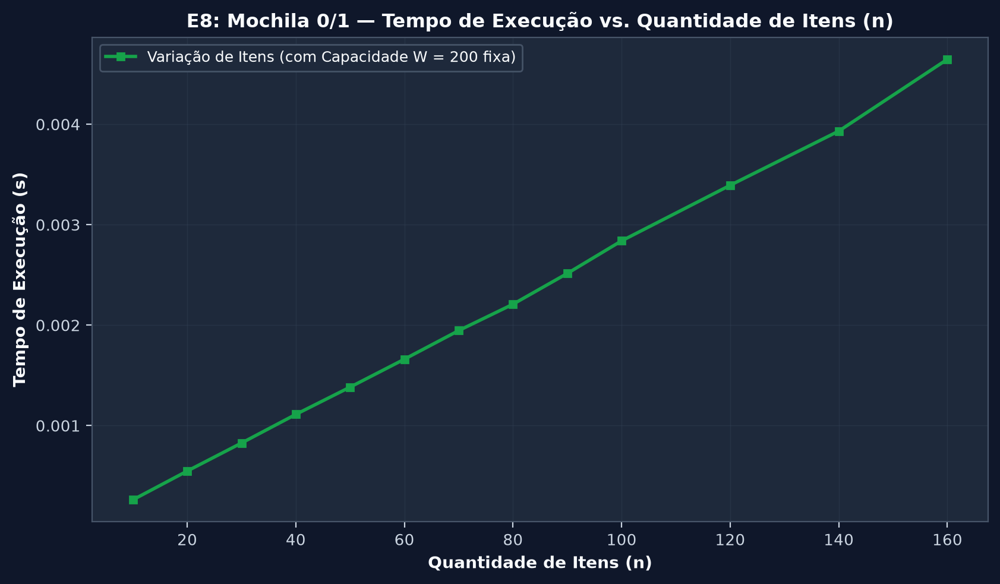

<p align="center">
  
</p>

# Análise Teórica e Empírica de Algoritmos em Programação Dinâmica: Complexidade, Otimizações e Estudos de Caso

[](https://www.linux.org/)
[](https://www.python.org/)
[-00599C?logo=cplusplus&logoColor=white)](https://isocpp.org/)
[](https://pytest.org/)
[](https://www.overleaf.com/)
[](https://github.com/Ribeiro-JP/Trabalho-AEDS-II-Programaco-Dinamica)
[](LICENSE)

<p align="center">
  <a href="https://ribeiro-jp.github.io/Trabalho-AEDS-II-Programaco-Dinamica/index.html"><b>🌐 Acessar o PD LAB — Portal Interativo</b></a>
  &nbsp;|&nbsp;
  <a href="https://ribeiro-jp.github.io/Trabalho-AEDS-II-Programaco-Dinamica/benchmarks.html"><b>📊 Painel de Benchmarks</b></a>
  &nbsp;|&nbsp;
  <a href="https://ribeiro-jp.github.io/Trabalho-AEDS-II-Programaco-Dinamica/quiz.html"><b>🧠 Quiz</b></a>
</p>

---

## Sumário Executivo

Este repositório documenta uma investigação teórica e experimental sobre **Programação Dinâmica (PD)**, realizada na disciplina **Algoritmos e Estruturas de Dados II (AEDS II)** do **CEFET-MG — Campus Divinópolis**, sob orientação do Prof. Michel Pires da Silva. O projeto toma como referência o capítulo de Programação Dinâmica de Cormen et al. e compara **recursão ingênua**, **top-down com memoização**, **bottom-up com tabulação** e **otimizações espaciais**.

O trabalho compreende:

1. **Fundamentação matemática e corretude:** recorrências, casos-base, subestrutura ótima, subproblemas sobrepostos e análises assintóticas para Fibonacci, corte de hastes, cadeia de matrizes, LCS e mochila 0/1.
2. **Aplicações didáticas:** Mini Diff baseado em LCS de linhas e estudo de alinhamento global/distância de edição em sequências de DNA.
3. **Experimentação reproduzível:** experimentos **E1–E8**, cinco repetições por ponto na rodada completa, medições de tempo separadas das medições de memória, CSVs e metadados de ambiente.
4. **Portal interativo PD LAB:** simuladores de algoritmos passo a passo, painel de gráficos e quiz conceitual de oito questões.

Os tempos relatados são **observações em um ambiente experimental específico**. Complexidade teórica, contagem de chamadas, tempo medido e alocações rastreadas são grandezas diferentes e são tratadas separadamente.

---

## 🔍 Índice de Navegação

- [Contexto Acadêmico](#-contexto-acadêmico)
- [Objetivos Acadêmicos](#-objetivos-acadêmicos)
- [Algoritmos Estudados](#-algoritmos-estudados)
- [Comparação Teórica e Assintótica](#-comparação-teórica-e-assintótica)
- [Estrutura do Projeto](#-estrutura-do-projeto)
- [Tecnologias Utilizadas](#-tecnologias-utilizadas)
- [Comandos do Makefile](#-comandos-do-makefile)
- [Ambiente Experimental e Metodologia](#-ambiente-experimental-e-metodologia)
- [Resultados Experimentais](#-resultados-experimentais)
- [Discussão dos Resultados](#-discussão-dos-resultados)
- [Limitações do Projeto](#-limitações-do-projeto)
- [Situação dos Entregáveis](#-situação-dos-entregáveis)
- [Referências Acadêmicas](#-referências-acadêmicas)
- [Autores](#autores)

---

## 🎓 Contexto Acadêmico

- **Instituição:** Universidade Federal de Ciência e Inovação (UFCIMG) — Campus Divinópolis.
- **Curso:** Engenharia da Computação.
- **Departamento:** Departamento de Computação.
- **Disciplina:** Algoritmos e Estruturas de Dados II (AEDS II).
- **Professor:** Michel Pires da Silva.
- **Tema:** Programação Dinâmica e suas aplicações (Cormen et al., Capítulo 15).
- **Equipe:** Alisson Henrique, Carlos Daniel, João Gabriel Santos, João Pedro Ribeiro e Paulo Henrique.

---

##  Objetivos Acadêmicos

### Análise Teórica versus Prática

- Formular e justificar as recorrências e os estados dos algoritmos estudados.
- Comparar quantitativamente custos como $\Theta(\varphi^n)$ versus $\Theta(n)$ em Fibonacci, $\Theta(2^n)$ versus $\Theta(n^2)$ no corte de hastes e $\Theta(3^n)$ versus $\Theta(n^3)$ na cadeia de matrizes.
- Distinguir o crescimento do **número de parentizações de Catalan**, $\Theta(4^n/n^{3/2})$, do número de **chamadas** da recursão ingênua na cadeia de matrizes ($3^{n-1}$).
- Avaliar limitações de pilha, custo de memória e diferenças empíricas de implementação entre Python e C++.

### Subestrutura Ótima e Subproblemas Sobrepostos

- Demonstrar subestrutura ótima **nas formulações adequadas** para os problemas selecionados, sem pressupor que toda formulação possua essa propriedade.
- Mostrar por que o reaproveitamento de estados pode eliminar recomputações.
- Investigar situações em que uma heurística gulosa não garante o valor ótimo.

### Otimizações de Espaço e Reconstrução

- Contrastar tabela completa, duas linhas e vetor unidimensional.
- Diferenciar o cálculo do **valor ótimo** da recuperação das **escolhas** que o produzem (*traceback*).
- Discutir os limites de interpretação das medições realizadas com `tracemalloc`.

### Comparação entre Linguagens

- Comparar as implementações de LCS em CPython e C++17 compilado com `-O3` nas mesmas entradas.
- Separar a **aceleração medida** de hipóteses sobre suas causas: representação de objetos, compilação e organização dos dados não foram isoladas experimentalmente.

---

##  Algoritmos Estudados

### 1. Sequência de Fibonacci (Problema de Aquecimento)

$$
F_0=0,\quad F_1=1,\qquad F_n=F_{n-1}+F_{n-2}\quad(n\ge2).
$$

- **Recursão ingênua:** $2F_{n+1}-1=\Theta(\varphi^n)$ invocações; pilha $O(n)$.
- **Memoização:** $\Theta(n)$ operações no modelo de custo unitário e $\Theta(n)$ posições de cache/pilha. Na implementação que armazena apenas $F_2,\ldots,F_n$, um cache inicialmente vazio gera exatamente **$2n-1$ invocações totais para $n\ge2$**, das quais $n-1$ calculam estados novos.
- **Bottom-up:** $\Theta(n)$ tempo e $\Theta(n)$ espaço com tabela completa.
- **Bottom-up otimizado:** $\Theta(n)$ tempo e $O(1)$ posições auxiliares no modelo de palavras.

**Ressalva aritmética:** $F_n$ tem $\Theta(n)$ bits. Em aritmética de precisão arbitrária, o custo em bits das somas e do armazenamento de valores não é constante; a tabulação usual exige $\Theta(n^2)$ operações de bit por somas sucessivas.

### 2. Corte de Hastes / *Rod Cutting* (Cormen 15.1)

Para preços $p_i$ e comprimento $n$:

$$
r_0=0,\qquad r_n=\max_{1\le i\le n}(p_i+r_{n-i}).
$$

A implementação contempla recursão ingênua, memoização, tabulação estendida e reconstrução dos cortes por uma tabela $s$. A recursão ingênua executa $2^n$ invocações; as abordagens clássicas de PD usam $\Theta(n^2)$ tempo e $\Theta(n)$ espaço. Há ainda uma heurística gulosa por densidade $p_i/i$, utilizada como contraste experimental — **não** como solução exata garantida.

Contraexemplo: para $p=(1,5,8,9)$ e $n=4$, a escolha gulosa inicial do pedaço de comprimento 3 produz receita 9; a solução ótima são dois pedaços de comprimento 2, com receita 10.

### 3. Multiplicação em Cadeia de Matrizes (Cormen 15.2)

Para $A_i$ de dimensões $p_{i-1}\times p_i$:

$$
m[i,i]=0,\quad m[i,j]=\min_{i\le k<j}\{m[i,k]+m[k+1,j]+p_{i-1}p_kp_j\}.
$$

A tabulação por diagonais usa $\Theta(n^3)$ tempo e $\Theta(n^2)$ espaço, com reconstrução pela tabela $s[i,j]$. A recursão ingênua dessa formulação realiza $3^{n-1}$ invocações; já o número de parentizações distintas é $C_{n-1}=\Theta(4^n/n^{3/2})$. Essas são duas grandezas diferentes.

Na memoização, o número de **estados distintos** é $n(n+1)/2$. Isso não deve ser confundido com o total de invocações da função recursiva; na formulação clássica, com chamada em cada divisão, esse total é $1+(n^3-n)/3$. Para as dimensões $[30,35,15,5,10,20,25]$, o custo ótimo é **15.125 multiplicações escalares**.

### 4. Maior Subsequência Comum / LCS (Cormen 15.4)

$$
c[i,j]=\begin{cases}
0,& i=0\text{ ou }j=0;\\
c[i-1,j-1]+1,&x_i=y_j;\\
\max(c[i-1,j],c[i,j-1]),&x_i\ne y_j.
\end{cases}
$$

A tabela completa usa $\Theta(mn)$ tempo e espaço, permitindo reconstrução pela matriz de direções. Se apenas o comprimento for necessário, duas linhas são suficientes, com espaço $\Theta(\min(m,n))$. A reconstrução com espaço linear também pode ser obtida por técnicas como a de Hirschberg. Existe implementação em C++17 para comparação experimental.

**Estudos de caso:** `src/case_study/diff_tool.py` realiza comparação textual linha a linha via LCS; `src/case_study/dna_alignment.py` explora alinhamento global e distância de edição em sequências biológicas.

### 5. Problema da Mochila 0/1 (*Knapsack*)

$$
V[i,w]=\begin{cases}
V[i-1,w],&w_i>w;\\
\max(V[i-1,w],V[i-1,w-w_i]+v_i),&w_i\le w.
\end{cases}
$$

A tabulação completa usa $\Theta(nW)$ tempo e $\Theta(nW)$ espaço; a versão em vetor único, com capacidades percorridas em ordem decrescente, reduz o espaço para $\Theta(W)$. Como $W$ é codificado em $O(\log W)$ bits, a complexidade é **pseudopolinomial**, e não necessariamente polinomial no tamanho da entrada.

---

##  Comparação Teórica e Assintótica

A tabela resume os custos no **modelo unitário de operações elementares**. Para Fibonacci de precisão arbitrária, o armazenamento dos números e o custo das somas em bits não são constantes.

| Problema | Abordagem | Tempo | Espaço auxiliar/tabelas | Reconstrução |
| :--- | :--- | :---: | :---: | :--- |
| **Fibonacci** | Recursão ingênua | $\Theta(\varphi^n)$ | $O(n)$ (pilha) | Não se aplica |
| **Fibonacci** | Top-down memoização | $\Theta(n)$ | $\Theta(n)$ (cache + pilha) | Não se aplica |
| **Fibonacci** | Bottom-up tabulação | $\Theta(n)$ | $\Theta(n)$ | Não se aplica |
| **Fibonacci** | Bottom-up — duas variáveis | $\Theta(n)$ | $O(1)$ posições auxiliares | Não se aplica |
| **Corte de hastes** | Recursão ingênua | $\Theta(2^n)$ | $O(n)$ (pilha) | Não diretamente |
| **Corte de hastes** | Top-down memoização | $\Theta(n^2)$ | $\Theta(n)$ | Com tabela de escolhas |
| **Corte de hastes** | Bottom-up estendido | $\Theta(n^2)$ | $\Theta(n)$ | Sim, via $s[j]$ |
| **Cadeia de matrizes** | Recursão ingênua da recorrência clássica | $\Theta(3^n)$ | $O(n)$ (pilha) | Não diretamente |
| **Cadeia de matrizes** | Top-down memoização | $\Theta(n^3)$ | $\Theta(n^2)$ | Com tabela de escolhas |
| **Cadeia de matrizes** | Bottom-up diagonais | $\Theta(n^3)$ | $\Theta(n^2)$ | Sim, via $s[i,j]$ |
| **LCS** | Recursão ingênua | $O(2^{m+n})$ | $O(m+n)$ (pilha) | Não diretamente |
| **LCS** | Bottom-up, tabela completa | $\Theta(mn)$ | $\Theta(mn)$ | Sim |
| **LCS** | Bottom-up, duas linhas | $\Theta(mn)$ | $\Theta(\min(m,n))$ | Apenas comprimento, diretamente |
| **LCS em C++17** | Bottom-up com `-O3` | $\Theta(mn)$ | $\Theta(mn)$ | Sim |
| **Mochila 0/1** | Bottom-up, tabela 2D | $\Theta(nW)$ | $\Theta(nW)$ | Sim, via tabela |
| **Mochila 0/1** | Bottom-up, vetor 1D | $\Theta(nW)$ | $\Theta(W)$ | Apenas valor, diretamente |
| **Caixeiro-viajante** | Held–Karp | $O(n^2 2^n)$ | $O(n2^n)$ | Com decisões armazenadas |

**Observações:**

- As cotas $O$ e $\Omega$ significam limites assintóticos superior e inferior, respectivamente; não representam automaticamente pior e melhor caso.
- Para a cadeia de matrizes, $C_{n-1}=\Theta(4^n/n^{3/2})$ conta **parentizações**, não chamadas da implementação recursiva ingênua.
- A mochila 0/1 é **pseudopolinomial** em $W$; Held–Karp é exponencial, apesar de usar Programação Dinâmica.
- Algoritmos de espaço linear como Hirschberg também permitem reconstruir uma LCS, embora não sejam as implementações de duas linhas simples usadas no E3.

---

## 📁 Estrutura do Projeto

```text
Trabalho-AEDS-II-Programaco-Dinamica/
├── README.md                           # Documentação, metodologia e resultados
├── LICENSE                             # Licença MIT
├── Makefile                            # Automação de instalação, testes, benchmarks e web
├── requirements.txt                    # Dependências Python
├── conftest.py                         # Configuração de testes
├── .github/workflows/deploy-pages.yml # Publicação do PD LAB no GitHub Pages
├── src/                                # Implementações algorítmicas em Python
│   ├── fibonacci.py                    # Ingênuo, Memo, Bottom-Up e espaço otimizado
│   ├── rod_cutting.py                  # Ingênuo, Memo, Bottom-Up, guloso e reconstrução
│   ├── matrix_chain.py                 # Ingênuo, Memo, DP e Catalan
│   ├── lcs.py                          # Ingênuo, Memo, tabelas e duas linhas
│   ├── knapsack.py                     # Mochila 0/1 em 2D e 1D
│   └── case_study/
│       ├── diff_tool.py                # Mini Diff baseado em LCS
│       └── dna_alignment.py            # Alinhamento e distância de edição
├── cpp/
│   └── lcs.cpp                         # LCS C++17, saída JSON para E4
├── data/                               # Entradas de demonstração textual e FASTA
├── tests/                              # Casos unitários e de infraestrutura (48 previstos)
│   ├── test_fibonacci.py
│   ├── test_rod_cutting.py
│   ├── test_matrix_chain.py
│   ├── test_lcs.py
│   ├── test_case_study.py
│   └── test_benchmarks.py
├── benchmarks/
│   ├── run_benchmarks.py               # Coleta experimental E1–E8
│   ├── plot_results.py                 # Gráficos científicos
│   └── results/
│       ├── all_benchmarks.csv          # Base consolidada
│       ├── e1_fibonacci.csv
│       ├── e2_rod_cutting.csv
│       ├── e3_lcs_memory.csv
│       ├── e4_lcs_cpp.csv              # Nome efetivo do CSV de E4
│       ├── e5_recursion_limit.csv
│       ├── e6_greedy_failure.csv
│       ├── e7_matrix_chain.csv
│       ├── e8_knapsack.csv
│       └── machine.json                # Ambiente experimental
├── docs/figures/                       # Gráficos utilizados no README
└── web/                                # Portal PD LAB (GitHub Pages)
    ├── index.html
    ├── benchmarks.html
    ├── fib-tree.html
    ├── lcs-table.html
    ├── rod-cutting-duel.html
    ├── matrix-chain.html
    ├── quiz.html
    ├── css/style.css
    ├── js/shared.js
    ├── figures/
    └── data/
        ├── results.json
        └── manifest.json
```

**Nota:** a árvore representa a estrutura publicada na branch `main`. O PDF acadêmico final e o *Cheat Sheet* podem ser distribuídos separadamente; não são listados como arquivos do repositório quando não estão presentes nele.

---

##  Tecnologias Utilizadas

| Tecnologia | Utilização |
| :--- | :--- |
| **Python 3.12 / compatibilidade 3.11+** | Algoritmos, testes e medições |
| **C++17 / g++ `-O3`** | Implementação nativa de LCS para E4 |
| **pytest** | Testes unitários e de infraestrutura |
| **Matplotlib e pandas** | Geração de gráficos e manipulação dos CSVs |
| **HTML, CSS e JavaScript** | PD LAB, simuladores, gráficos e quiz |
| **GitHub Pages / Actions** | Publicação automatizada do site |
| **LaTeX (`algorithm2e`)** | Relatório acadêmico e pseudocódigos do documento entregue separadamente |
| **Make** | Comandos reproduzíveis de instalação, compilação e benchmark |

---

##  Comandos do Makefile

Recomenda-se Linux ou WSL2, com Python, `pip`, `make` e (para E4) `g++` disponíveis.

```bash
git clone https://github.com/Ribeiro-JP/Trabalho-AEDS-II-Programaco-Dinamica.git
cd Trabalho-AEDS-II-Programaco-Dinamica
make setup
make test
```

| Alvo (`make`) | Operação | Finalidade |
| :--- | :--- | :--- |
| `make help` | Lista os alvos | Consulta dos comandos |
| `make setup` | Cria `.venv`, atualiza `pip` e instala dependências | Preparação do ambiente |
| `make test` | Executa `pytest tests/ -v` (usando o ambiente disponível) | Validação das implementações |
| `make cpp` | Compila `cpp/lcs.cpp` com `-O3 -std=c++17` | Preparação da versão C++ da LCS |
| `make bench-quick` | Executa `run_benchmarks.py --quick` | Teste rápido da infraestrutura |
| `make bench` | Executa `run_benchmarks.py` | Rodada completa E1–E8 |
| `make web` | Inicia `python3 -m http.server 8000` | Abrir `http://localhost:8000/web/` |
| `make clean` | Remove caches e binários gerados | Limpeza do ambiente |

O comando `make test` pode ser executado sem compilar C++ manualmente. Para resultados comparáveis ao E4, é necessária a disponibilidade de compilador C++ no ambiente de benchmark. **Não existe alvo `make report` no Makefile atual.**

---

##  Ambiente Experimental e Metodologia

A rodada documentada no relatório foi executada em **14/10/2026**, em Linux sob WSL2, com **AMD Ryzen 5 4600G**, **CPython 3.12.3** e **g++ 13.3** usando `-O3 -std=c++17`. A interpretação das medições deve levar em conta a máquina e os demais processos ativos.

- **Tempo:** `time.perf_counter()`; aquecimento e cinco repetições por ponto, usando média aparada das três observações centrais.
- **Medições muito curtas:** uso de medições em lote (*batching*) quando apropriado, reduzindo a influência da resolução do relógio.
- **Exponenciais:** limites de tempo por execução e faixas menores de entrada para tornar a comparação viável.
- **Memória:** `tracemalloc` em medições separadas. Ele registra **alocações rastreadas pelo Python**, não a memória física total, o RSS ou toda alocação nativa.
- **Cache de Fibonacci:** E1 distingue **cache frio** (novo dicionário a cada execução completa) e **cache quente** (consulta a resultado já armazenado). A consulta quente, de custo $O(1)$ no modelo unitário, não representa o custo de resolver o problema.
- **Limite de recursão:** E1 aumenta temporariamente `sys.setrecursionlimit()` quando necessário (limite ao menos `max(pd_ns) + 500`) e restaura o valor anterior ao final. E5 utiliza um limite controlado para investigar `RecursionError`. Assim, o sucesso da memoização em E1 para $n=2000$ não contradiz a falha perto de $n=1000$ em E5.
- **Reprodutibilidade:** semente pseudoaleatória fixa nos experimentos aplicáveis. Repetir o código não garante reproduzir os mesmos tempos exatos, que dependem do ambiente de execução.

**Artefatos para conferência:** [CSVs de E1–E8](benchmarks/results), [executor de benchmarks](benchmarks/run_benchmarks.py), [gerador dos gráficos](benchmarks/plot_results.py) e [metadados do ambiente](benchmarks/results/machine.json). Os resultados numéricos abaixo vêm da rodada documentada, e não de uma nova execução deste README.

---

##  Resultados Experimentais

### E1: Fibonacci (Recursão Exponencial versus Programação Dinâmica)

<p align="center">
  
  
</p>
<p align="center">
  
  
</p>

- **Crescimento ingênuo:** para $n=30$, **2.692.537 chamadas** e aproximadamente **0,4285 s**; para $n=32$, **7.049.155 chamadas** e **1,14 s**.
- **Memoização com cache frio:** para $n=30$, **59 chamadas**, contra milhões na recursão ingênua. Para $n=2000$, o tempo medido foi aproximadamente **927 µs** (com limite de recursão temporariamente elevado).
- **Bottom-up e duas variáveis:** para $n=2000$, aproximadamente **165 µs** e **92 µs**, respectivamente.
- **Consulta com cache quente:** a curva mede **somente a recuperação de um resultado pré-calculado**, e não uma resolução completa do problema. A curva denominada espaço $O(1)$ representa **tempo da variante de duas variáveis**, não memória no eixo Y.
- **Limite do experimento:** a versão ingênua foi **avaliada somente até $n=32$**; não há registro de execução interrompida para $n>32$ nessa rodada.

---

### E2: Corte de Hastes (Cormen 15.1) e Qualidade do Guloso

<p align="center">
  
  
</p>

- A recursão ingênua chega a **1.048.576 chamadas** e **0,399 s** em $n=20$, coerente com crescimento exponencial.
- A tabulação completa processa $n=100$ em aproximadamente **0,202 ms** na rodada relatada.
- A heurística de densidade pode falhar; ela não fornece certificado universal de otimalidade.

---

### E3: LCS — Consumo de Memória e Tempo

<p align="center">
  
  
</p>

- Em duas sequências de tamanho $1000$, a tabela completa registrou **20.085.696 B** e a versão de duas linhas **43.952 B** de pico rastreado por `tracemalloc`.
- A relação é de aproximadamente **457 vezes** (economia perto de **99,8%**). Isso é **pico rastreado**, não medida direta de RSS nem de toda RAM física.
- A versão de duas linhas determina o **comprimento** da LCS; reconstrução em espaço linear requer estratégia adicional, como Hirschberg.

---

### E4: CPython versus C++17 (LCS, `-O3`)

<p align="center">
  
  
</p>

- Para cadeias de comprimento $1000$, CPython: **173,3 ms**; C++17: **1,08 ms**, com aceleração de aproximadamente **161 vezes**.
- Ambas as implementações pertencem à classe $\Theta(mn)$ e retornam LCS corretas nas instâncias verificadas.
- **Limitação:** Python utiliza também uma tabela auxiliar de direções; C++ reconstrói a solução diretamente da tabela de comprimentos. Não se trata de uma comparação que isole exclusivamente a linguagem, nem de prova causal de efeitos de *boxing* ou de memória contígua.

---

### E5: Limites de Recursão em Python

<p align="center">
  
  
</p>

- Com limite controlado de recursão igual a **1000**, o top-down conclui a entrada $n=990$ e registra `RecursionError` em $n=1000$.
- O bottom-up é iterativo e não depende da profundidade recursiva, mas continua limitado pelo tempo e pela memória disponíveis.
- Em E1 o limite foi elevado temporariamente, razão pela qual os resultados para $n=2000$ não contradizem E5.

---

### E6: Simulação da Falha Gulosa no Corte de Hastes

<p align="center">
  
</p>

- Foram avaliadas **200 instâncias por comprimento**, com semente pseudoaleatória **42**.
- As taxas de falha variaram conforme as entradas; o máximo observado foi **24%** (por exemplo, $n=18$ e $n=26$), e a maior perda média registrada foi **7,18%** ($n=5$, entre as falhas).
- Isso demonstra que a heurística testada **não garante** a solução ótima; não implica que sua taxa de falha seja sempre 24% em qualquer distribuição.

---

### E7: Cadeia de Matrizes e Números de Catalan

<p align="center">
  
  
</p>

- Em $n=50$, a rodada registrou aproximadamente **3,13 ms** em bottom-up e **11,5 ms** em memoização. Em $n=75$, bottom-up registrou aproximadamente **9,44 ms**.
- O número de parentizações é $C_{n-1}=\Theta(4^n/n^{3/2})$; o número de chamadas da recursão ingênua clássica é **$3^{n-1}$**, grandezas que não devem ser confundidas.
- Em $n=75$, a versão memoizada possui **2.850 estados distintos**, porém **140.601 invocações totais** na implementação que chama recursivamente cada transição (incluindo acertos de cache).
- **Atenção ao CSV:** a coluna `calls` para E7 memo foi preenchida com o **número de estados distintos** $n(n+1)/2$, apesar do nome genérico. Não deve ser interpretada como o total de invocações.

---

### E8: Mochila 0/1 — Dependência de $W$ e de $n$

<p align="center">
  
  
</p>
<p align="center">
  
</p>

- Com $n=50$ itens fixos, o tempo de tabulação aumenta com a capacidade numérica $W$, coerente com $\Theta(nW)$.
- Em $W=1000$, tabela 2D: **1.633.600 B**; vetor 1D: **40.192 B** de alocações rastreadas (**97,5%** de redução).
- O experimento complementar mantém $W=200$ fixo e aumenta a quantidade de itens. As duas comparações isolam variáveis diferentes.

**Dados:** [CSVs de cada experimento](benchmarks/results) · [Gráficos adicionais no PD LAB](https://ribeiro-jp.github.io/Trabalho-AEDS-II-Programaco-Dinamica/benchmarks.html)

---

##  Discussão dos Resultados

1. **Adequação da PD:** subestrutura ótima e subproblemas sobrepostos tornam uma formulação candidata natural à técnica, **mas não obrigam seu uso**. O E6 demonstra que o guloso de densidade pode ser subótimo sob os preços simulados.
2. **Top-down versus bottom-up:** na mesma formulação, ambas podem ter a mesma ordem assintótica, mas custo de recursão, conjunto de estados efetivamente visitados e restrições práticas podem diferir (E1, E2, E5, E7).
3. **Algoritmo versus linguagem:** a diferença de cerca de **161 vezes** observada em E4 compara as versões Python/C++ efetivamente implementadas. Ela não isolou a contribuição de cada detalhe de compilador, armazenamento ou execução.
4. **Memória versus reconstrução:** em E3 e E8, versões compactas economizam memória ao preservar apenas o necessário para calcular o valor; guardar escolhas ou recorrer a algoritmos adicionais permite reconstruir soluções em outros compromissos de espaço/tempo.
5. **Interpretação de gráficos:** uma curva identificada por “espaço $O(1)$” no E1 é a **variante de Fibonacci**, mas o eixo vertical do gráfico fino mede **tempo**. Cache quente mede consulta, não cálculo completo.
6. **Evidência experimental:** tendências observadas apoiam as análises teóricas sem constituir demonstrações matemáticas por si só; gráficos e estimativas são específicos da máquina, das entradas e do protocolo de amostragem.

---

##  Limitações do Projeto

1. **Pseudopolinomialidade e exponencialidade:** na mochila 0/1, $\Theta(nW)$ é pseudopolinomial porque a capacidade pode ser grande em relação à sua codificação binária. Held–Karp para caixeiro-viajante permanece exponencial, com $O(n^2 2^n)$ tempo e $O(n2^n)$ espaço.
2. **Maior caminho simples em grafos gerais:** combinar apenas os melhores subcaminhos pode falhar, pois os caminhos escolhidos podem compartilhar vértices. Isso **não impede PD**: incluir no estado o subconjunto de vértices visitados e o vértice final permite uma formulação exponencial, com tempo $O(n^2 2^n)$ e espaço $O(n2^n)$. A subestrutura ótima depende da definição do estado.
3. **Memória em entradas extensas:** LCS com tabela completa utiliza espaço quadrático; duas linhas calculam somente o comprimento, e Hirschberg é uma alternativa para reconstruir com espaço linear.
4. **Medição:** `tracemalloc` não fornece RSS nem RAM total; medições submicrossegundo possuem ruído; cinco repetições e uma configuração experimental não autorizam conclusões universais.
5. **C++ versus Python:** diferenças de implementação além da linguagem e do compilador limitam inferências causais do E4.
6. **Limite de recursão:** aumentar `sys.setrecursionlimit()` não elimina limites físicos de pilha ou de memória; a versão bottom-up é preferível quando evitar recursão for uma exigência.

---

##  Referências Acadêmicas

1. **CORMEN, Thomas H.; LEISERSON, Charles E.; RIVEST, Ronald L.; STEIN, Clifford.** *Algoritmos: Teoria e Prática*. 3. ed. Rio de Janeiro: Elsevier, 2012. Capítulo 15: Programação Dinâmica.
2. **BELLMAN, Richard.** *Dynamic Programming*. Princeton University Press, 1957.
3. **HELD, Michael; KARP, Richard M.** A dynamic programming approach to sequencing problems. *Journal of the Society for Industrial and Applied Mathematics*, 10(1), 1962.
4. **NEEDLEMAN, Saul B.; WUNSCH, Christian D.** A general method applicable to the search for similarities in the amino acid sequence of two proteins. *Journal of Molecular Biology*, 48(3), 1970.
5. **HIRSCHBERG, Daniel S.** A linear space algorithm for computing maximal common subsequences. *Communications of the ACM*, 18(6), 1975.
6. **KLEINBERG, Jon; TARDOS, Éva.** *Algorithm Design*. Addison-Wesley, 2006.
7. **SEDGEWICK, Robert; WAYNE, Kevin.** *Algorithms*. 4. ed. Addison-Wesley, 2011.

---

## Autores

**Projeto:** Estratégias Avançadas de Projeto e Análise de Algoritmos: Programação Dinâmica  
**Instituição:** Universidade Federal de Ciência e Inovação (UFCIMG) — Campus Divinópolis  
**Disciplina:** Algoritmos e Estruturas de Dados II (AEDS II)  
**Professor:** <a href="https://github.com/mpiress">Michel Pires da Silva</a>

<table align="center">
  <tr>
    <td align="center" width="20%"><a href="https://github.com/alisson-h"><br/><b>Alisson Henrique</b></a></td>
    <td align="center" width="20%"><a href="https://github.com/zCarlos17"><br/><b>Carlos Daniel</b></a></td>
    <td align="center" width="20%"><a href="https://github.com/Joao-santos-oliveira"><br/><b>João Gabriel Santos</b></a></td>
    <td align="center" width="20%"><a href="https://github.com/Ribeiro-JP"><br/><b>João Pedro Ribeiro</b></a></td>
    <td align="center" width="20%"><a href="https://github.com/Paulohenrish"><br/><b>Paulo Henrique</b></a></td>
  </tr>
</table>

---

<p align="center">
  <b>CEFET-MG — Departamento de Computação — Campus Divinópolis</b><br/>
  Trabalho Acadêmico de Algoritmos e Estruturas de Dados II — 2026
</p>
