<p align="center">
  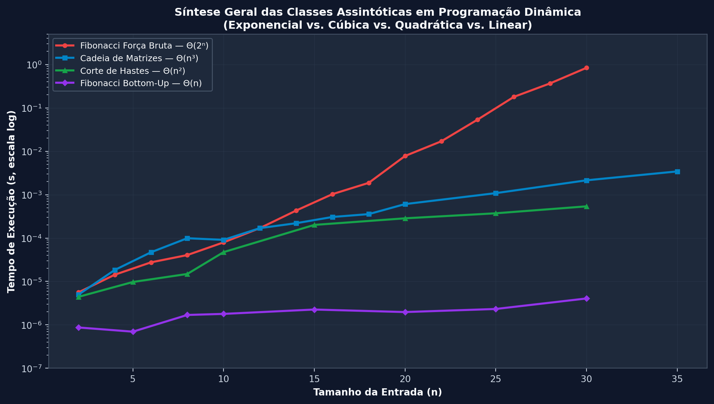
</p>

# Análise Teórica e Empírica de Algoritmos em Programação Dinâmica: Complexidade, Otimizações e Estudos de Caso

[](https://www.linux.org/)
[](https://www.python.org/)
[-00599C?logo=cplusplus&logoColor=white)](https://isocpp.org/)
[](https://pytest.org/)
[](https://www.overleaf.com/)
[](https://github.com/Ribeiro-JP/Trabalho-AEDS-II-Programaco-Dinamica)
[](LICENSE)

---

## 📋 Sumário Executivo

Este repositório contém uma investigação teórico-empírica rigorosa sobre o paradigma de **Programação Dinâmica (PD)**, desenvolvida no âmbito da disciplina de **Algoritmos e Estruturas de Dados II (AEDS-II)** do **CEFET-MG (Campus Divinópolis)** sob orientação do Prof. Michel Pires da Silva.

O projeto fundamenta-se nas formulações clássicas do livro *Algoritmos: Teoria e Prática* (Cormen et al., Capítulo 15), confrontando implementações de referência nas abordagens **recursiva ingênua (Força Bruta)**, **Top-Down com Memoização** e **Bottom-Up com Tabulação**, além de **otimizações avançadas de espaço de memória** ($O(1)$ variáveis rotativas, vetor unidimensional e matriz de duas linhas).

O trabalho contempla:
1. **Modelagem Matemática e Corretude:** Formulação exata das recorrências, casos-base, subestrutura ótima e prova de superposição de subproblemas para Fibonacci, Corte de Hastes (*Rod Cutting*), Multiplicação em Cadeia de Matrizes (*Matrix-Chain Multiplication*), Maior Subsequência Comum (*Longest Common Subsequence - LCS*) e Mochila 0/1 (*0/1 Knapsack*).
2. **Estudos de Caso Reais:** Aplicação prática de PD na ferramenta de comparação textual unificada (**Mini Diff** linha a linha via LCS) e na bioinformática computacional (**Alinhamento Global de Sequências de DNA** via Needleman-Wunsch / Levenshtein).
3. **Engenharia Experimental Científica:** Suíte automatizada de benchmarks (**Experimentos E1 a E8**) com isolamento de processos, tratamento de *timeouts* em funções exponenciais, medição de pico de memória via `tracemalloc`, média aparada (*trimmed mean*) de repetições, *batching* adaptativo para resolução sub-microssegundo e comparação de desempenho entre **CPython 3.11/3.12** e **C++17 compilado com `-O3`**.
4. **Portal Web Interativo e Didático:** Simuladores visuais interativos em JavaScript/CSS modernos com animação passo a passo de matrizes, reconstrução de caminhos (*traceback*), duelo contra heurística gulosa e catálogo dos 19 gráficos gerados a 200 DPI.

---

## 🔍 Índice de Navegação

- [Contexto Acadêmico](#-contexto-acadêmico)
- [Objetivos Acadêmicos](#-objetivos-acadêmicos)
- [Algoritmos Estudados](#-algoritmos-estudados)
- [Comparação Teórica e Assintótica](#-comparação-teórica-e-assintótica)
- [Estrutura do Projeto](#-estrutura-do-projeto)
- [Tecnologias Utilizadas](#-tecnologias-utilizadas)
- [Comandos do Makefile](#-comandos-do-makefile)
- [Ambiente Experimental e Metodologia](#-ambiente-experimental-e-metodologia)
- [Resultados Experimentais](#-resultados-experimentais)
- [Discussão dos Resultados](#-discussão-dos-resultados)
- [Limitações do Projeto](#-limitações-do-projeto)
- [O que Falta Ser Implementado](#-o-que-falta-ser-implementado)
- [Referências Acadêmicas](#-referências-acadêmicas)
- [Autores](#autores)

---

## 🎓 Contexto Acadêmico

* **Instituição:** Centro Federal de Educação Tecnológica de Minas Gerais (CEFET-MG) -- Campus Divinópolis
* **Departamento:** Departamento de Computação
* **Disciplina:** Algoritmos e Estruturas de Dados II (AEDS-II)
* **Professor Orientador:** Prof. Michel Pires da Silva
* **Tema Central:** Programação Dinâmica (Capítulo 15 do livro *Introduction to Algorithms*, Cormen et al.)
* **Participantes:** Alisson Henrique, Carlos Henrique, João Gabriel Santos, João Pedro Ribeiro e Paulo.

---

## 🎯 Objetivos Acadêmicos

### Análise Teórica vs. Prática
- **Validação experimental** das ordens de complexidade assintótica assinaladas pelo Cormen: $\Theta(2^n)$ vs. $\Theta(n)$ em Fibonacci, $\Theta(2^n)$ vs. $\Theta(n^2)$ em Rod Cutting, $\Omega(4^n/n^{3/2})$ vs. $\Theta(n^3)$ em Matrix-Chain, $\Theta(m \cdot n)$ em LCS e $O(n \cdot W)$ pseudo-polinomial na Mochila 0/1.
- **Quantificação de overhead de recursão**: impacto da pilha de chamadas (*call stack*), alocação de quadros de ativação e limites de sistema (`sys.getrecursionlimit()`).
- **Análise fina de constantes ocultas**: investigação de por que algoritmos com a mesma classe assintótica $\Theta(m \cdot n)$ apresentam ordens de grandeza distintas entre linguagens interpretadas e nativas.

### Subestrutura Ótima e Superposição de Subproblemas
- Prova de que problemas de otimização combinatória exibem subestrutura ótima formalizável por relações de recorrência.
- Comprovação empírica do colapso de **heurísticas gulosas** quando a *propriedade da escolha gulosa* não se sustenta (demonstrada via simulações com Monte Carlo no corte de hastes).

### Otimização Espacial e Trade-offs de Engenharia
- Isolamento e quantificação do custo de **recuperação de solução ótima (*traceback*)**:
  - Matriz bidimensional completa $(m+1) \times (n+1)$ para reconstrução exata da solução.
  - Redução drástica para **duas linhas rotativas** $\Theta(\min(m, n))$ ou **vetor unidimensional** $\Theta(W)$ quando apenas o valor escalar ótimo é requerido (redução de memória superior a $97\%$).

### Comparação Inter-linguagem (CPython vs. C++17)
- Isolamento de fatores de arquitetura de software: alocação contígua em heap vs. ponteiros de objetos em Python (*PyObject boxing*), vetorização e otimização por compilador nativo (`g++ -O3 -std=c++17`).

---

## 🔬 Algoritmos Estudados

### 1. Sequência de Fibonacci (Problema de Aquecimento)

#### Fundamentação Teórica
A sequência de Fibonacci ilustra de forma canônica o fenômeno da **superposição massiva de subproblemas**, onde subárvores idênticas são recalculadas exponencialmente na abordagem recursiva ingênua.

**Recorrência:**
$$F(0) = 0, \quad F(1) = 1$$
$$F(n) = F(n-1) + F(n-2), \quad \forall n \ge 2$$

#### Abordagens Implementadas
1. **Força Bruta (*Naive*):** Árvore recursiva pura com $2^{n-1}$ folhas. Complexidade: $\Theta(\phi^n) \approx \Theta(1.618^n)$ tempo, $O(n)$ espaço na pilha.
2. **Top-Down com Memoização:** Recursão guiada com tabela de dispersão (*cache*). Cada subproblema de $0$ a $n$ é computado uma única vez em $2n-1$ chamadas de função. Complexidade: $\Theta(n)$ tempo, $\Theta(n)$ espaço.
3. **Bottom-Up (Tabulação Linear):** Preenchimento iterativo de vetor unidimensional a partir dos casos-base. Complexidade: $\Theta(n)$ tempo, $\Theta(n)$ espaço.
4. **Espaço Otimizado $O(1)$:** Mantém apenas as duas variáveis anteriores $a = F(n-2)$ e $b = F(n-1)$. Complexidade: $\Theta(n)$ tempo, $\Theta(1)$ espaço.

---

### 2. Corte de Hastes / Rod Cutting (Cormen Seção 15.1)

#### Fundamentação Teórica
Dada uma haste de comprimento $n$ e uma tabela de preços $p[1..n]$, determinar a receita máxima $r_n$ obtida cortando a haste em pedaços inteiros e vendendo-os.

**Recorrência Fundamental:**
$$r_0 = 0$$
$$r_n = \max_{1 \le i \le n} \left( p[i] + r_{n-i} \right), \quad \forall n \ge 1$$

#### Algoritmo Estendido e Reconstrução
- **Extended-Bottom-Up-Cut-Rod:** Constrói a tabela de receitas ótimas $r[0..n]$ e a tabela auxiliar de escolhas $s[0..n]$, onde $s[j]$ armazena o tamanho do primeiro pedaço cortado para a haste de comprimento $j$.
- **Reconstruct-Cuts:** Algoritmo iterativo de *traceback* que recupera a partição exata dos pedaços em tempo $O(n)$.
- **Duelo contra a Heurística Gulosa:** Implementação da estratégia gulosa por densidade de valor ($p[i] / i$). No contraexemplo canônico $p = [0, 1, 5, 8, 9]$ com $n = 4$:
  - Guloso escolhe pedaço de tamanho 3 (razão $2.67$, sobra 1) $\to$ Receita $8 + 1 = 9$.
  - Programação Dinâmica escolhe dois pedaços de tamanho 2 $\to$ Receita $5 + 5 = 10$ (**Ótimo global**).

**Complexidade:** $\Theta(n^2)$ tempo, $\Theta(n)$ espaço para PD; $\Theta(2^n)$ para a recursão ingênua.

---

### 3. Multiplicação em Cadeia de Matrizes (Cormen Seção 15.2)

#### Fundamentação Teórica
Dada uma cadeia de $n$ matrizes $\langle A_1, A_2, \dots, A_n \rangle$ onde $A_i$ possui dimensão $p_{i-1} \times p_i$, determinar a parentização completa que minimiza o número total de multiplicações escalares.

A busca exaustiva é inviável porque a quantidade de parentizações possíveis corresponde aos **Números de Catalan**:
$$P(n) = C(n-1) = \frac{1}{n}\binom{2n-2}{n-1} \sim \Omega\left(\frac{4^n}{n^{3/2}}\right)$$
Para $n=15$, existem mais de $2{,}6$ milhões de parentizações; para $n=50$, ultrapassa $5{,}1 \times 10^{26}$.

**Recorrência Fundamental:**
$$m[i, i] = 0, \quad \forall 1 \le i \le n$$
$$m[i, j] = \min_{i \le k < j} \left\{ m[i, k] + m[k+1, j] + p_{i-1} \cdot p_k \cdot p_j \right\}, \quad 1 \le i < j \le n$$

#### Estratégia de Preenchimento
O preenchimento da tabela $m[1..n, 1..n]$ ocorre **por diagonais crescentes** (comprimento de subcadeia $l = 2 \dots n$). A matriz auxiliar $s[i, j]$ registra o ponto de corte ótimo $k$.

- **Print-Optimal-Parens:** Reconstrução recursiva da expressão parentizada (ex.: `((A1(A2A3))((A4A5)A6))`).
- **Instância Canônica do Cormen:** `dims = [30, 35, 15, 5, 10, 20, 25]` $\to$ Custo ótimo: **15.125 multiplicações**.

**Complexidade:** $\Theta(n^3)$ tempo (laço triplo $l, i, k$), $\Theta(n^2)$ espaço.

---

### 4. Maior Subsequência Comum / LCS (Cormen Seção 15.4)

#### Fundamentação Teórica
Dadas duas sequências $X = \langle x_1, \dots, x_m \rangle$ e $Y = \langle y_1, \dots, y_n \rangle$, encontrar o comprimento e os elementos de uma subsequência comum de comprimento máximo.

**Recorrência Fundamental:**
$$c[i, j] = \begin{cases} 0 & \text{se } i = 0 \text{ ou } j = 0 \\ c[i-1, j-1] + 1 & \text{se } i, j > 0 \text{ e } x_i = y_j \\ \max(c[i-1, j], c[i, j-1]) & \text{se } i, j > 0 \text{ e } x_i \ne y_j \end{cases}$$

#### Variantes e Estudos de Caso
- **Tabela Completa com Direções:** Matriz $(m+1) \times (n+1)$ com setas de *traceback* (`diag`, `up`, `left`). Permite reconstruir a string ótima em tempo $O(m + n)$.
- **Otimização de Duas Linhas:** Como $c[i, j]$ depende unicamente das linhas $i$ e $i-1$, reduz o espaço para $\Theta(\min(m, n))$, mantendo a menor string como largura de linha.
- **Implementação C++17:** Binário nativo compilado com `-O3` para o experimento E4.
- **Mini Diff Textual (`diff_tool.py`):** Aplicação de LCS tratando linhas como tokens para gerar diffs unificados (`+`, `-`, ` `).
- **Alinhamento Global de DNA (`dna_alignment.py`):** Algoritmo de Needleman-Wunsch / Levenshtein com penalidade de gap (`-`) e cálculo de distância de edição sobre arquivos FASTA.

**Complexidade:** $\Theta(m \cdot n)$ tempo; Espaço $\Theta(m \cdot n)$ (tabela completa) ou $\Theta(\min(m, n))$ (duas linhas).

---

### 5. Problema da Mochila 0/1 / Knapsack (Módulo Opcional)

#### Fundamentação Teórica
Dado um conjunto de $n$ itens com pesos $w_i$ e valores $v_i$, e uma mochila com capacidade máxima $W$, determinar o subconjunto que maximiza o valor total sem exceder $W$.

**Recorrência Fundamental:**
$$V[0, w] = 0, \quad \forall 0 \le w \le W$$
$$V[i, w] = \begin{cases} V[i-1, w] & \text{se } w_i > w \\ \max(V[i-1, w], V[i-1, w - w_i] + v_i) & \text{se } w_i \le w \end{cases}$$

- **Caráter Pseudo-polinomial:** Complexidade $O(n \cdot W)$, dependente do valor numérico de $W$ e não apenas do número de bits da entrada.
- **Otimização 1D:** Itera capacidades de trás para frente ($W \dots w_i$), reduzindo o espaço de $O(n \cdot W)$ para $O(W)$.

---

## 📊 Comparação Teórica e Assintótica

| Problema | Abordagem | Complexidade de Tempo | Complexidade de Espaço | Traceback da Solução | Quando Utilizar |
| :--- | :--- | :---: | :---: | :---: | :--- |
| **Fibonacci** | Recursivo Ingênuo | $\Theta(\phi^n) \approx \Theta(1.618^n)$ | $O(n)$ pilha | N/A | Apenas didático para ilustrar redundância exponencial |
| **Fibonacci** | Top-Down Memoização | $\Theta(n)$ | $\Theta(n)$ cache + pilha | N/A | Quando nem todos os subproblemas precisam ser explorados |
| **Fibonacci** | Bottom-Up Tabulação | $\Theta(n)$ | $\Theta(n)$ tabela | N/A | Quando todos os subproblemas são necessários; evita pilha |
| **Fibonacci** | Espaço $O(1)$ | $\Theta(n)$ | $\Theta(1)$ | N/A | **Produção:** menor pegada de memória e execução contínua |
| **Corte de Hastes** | Recursivo Ingênuo | $\Theta(2^n)$ | $O(n)$ pilha | Não | Inviável para $n > 25$ |
| **Corte de Hastes** | Top-Down Memoização | $\Theta(n^2)$ | $\Theta(n)$ | Não | Instâncias esparsas |
| **Corte de Hastes** | Extended Bottom-Up | $\Theta(n^2)$ | $\Theta(n)$ | **Sim** (tabela $s$) | **Produção:** receita ótima e lista exata de pedaços |
| **Corte de Hastes** | Heurística Gulosa | $O(n \log n)$ | $O(n)$ | Sim | Falha em até 34% dos casos; inadequado sem prova |
| **Cadeia de Matrizes** | Recursivo Ingênuo | $3^{n-1}$ chamadas recursivas (espaço de Catalan $\Omega(4^n/n^{3/2})$) | $O(n)$ pilha | Não | Inviável para $n > 12$ devido às $3^{n-1}$ chamadas recursivas |
| **Cadeia de Matrizes** | Bottom-Up Diagonais | $\Theta(n^3)$ | $\Theta(n^2)$ | **Sim** (tabela $s$) | **Padrão ouro:** ordem ótima de parentização |
| **LCS** | Recursivo Ingênuo | $O(2^{m+n})$ | $O(m+n)$ pilha | Não | Apenas entradas minúsculas ($< 15$ caracteres) |
| **LCS** | Tabela Completa (Cormen) | $\Theta(m \cdot n)$ | $\Theta(m \cdot n)$ | **Sim** (matriz $b$) | Quando a subsequência de texto ou alinhamento é necessária |
| **LCS** | Duas Linhas (Otimizado) | $\Theta(m \cdot n)$ | $\Theta(\min(m, n))$ | Apenas comprimento | Economia de até 99,8% de RAM em strings biológicas |
| **LCS (C++17)** | Nativo compilado `-O3` | $\Theta(m \cdot n)$ | $\Theta(m \cdot n)$ | Sim | **Alto desempenho:** $161\times$ mais veloz que CPython |
| **Mochila 0/1** | Bottom-Up 2D | $O(n \cdot W)$ | $O(n \cdot W)$ | **Sim** | Quando a lista de itens escolhidos é requerida |
| **Mochila 0/1** | Vetor 1D Reverso | $O(n \cdot W)$ | $O(W)$ | Apenas valor máximo | Grande escala de $W$; economia massiva de memória |

---

## 📁 Estrutura do Projeto

```text
Trabalho-AEDS-II-Programaco-Dinamica/
├── README.md                           # Documentação técnica integral e guia de execução
├── LICENSE                             # Licença de código aberto MIT
├── Makefile                            # Build system com automação de testes, benchmarks e web
├── requirements.txt                    # Dependências Python (pytest, matplotlib, pandas, numpy)
├── conftest.py                         # Configuração e fixtures da suíte pytest
├── .editorconfig                       # Padrão consistente de tabulações e quebras de linha
├── .gitignore                          # Exclusões de ambiente virtual, compilações e caches
│
├── src/                                # Implementações de referência em Python
│   ├── __init__.py
│   ├── common.py                       # CallCounter, instrumentação e medição de memória
│   ├── fibonacci.py                    # Naive, Memo, Bottom-Up e O(1) Espaço
│   ├── rod_cutting.py                  # Naive, Memo, Extended Bottom-Up e Heurística Gulosa
│   ├── matrix_chain.py                 # Naive, Memo, Matrix-Chain-Order e Catalan
│   ├── lcs.py                          # Naive, Memo, Tabela Completa e Duas Linhas
│   ├── knapsack.py                     # Mochila 0/1 2D e Vetor 1D com iteração reversa
│   └── case_study/                     # Estudos de caso de aplicação prática
│       ├── __init__.py
│       ├── diff_tool.py                # Comparador de arquivos linha a linha via LCS
│       └── dna_alignment.py            # Alinhamento global e distância de Levenshtein
│
├── cpp/                                # Implementação de alto desempenho em linguagem nativa
│   └── lcs.cpp                         # LCS Bottom-Up em C++17 com flags -O3 e saída JSON
│
├── data/                               # Arquivos de dados reais para os estudos de caso
│   ├── texto_a.txt                     # Versão original de arquivo de código/texto
│   ├── texto_b.txt                     # Versão modificada com adições e remoções
│   ├── dna_a.fasta                     # Sequência biológica de nucleotídeos A
│   └── dna_b.fasta                     # Sequência biológica de nucleotídeos B
│
├── tests/                              # Suíte completa de testes automatizados (48 testes)
│   ├── test_fibonacci.py               # Casos Cormen, equivalências e limites de chamadas
│   ├── test_rod_cutting.py             # Tabela Cormen 1..10, reconstrução e falha do guloso
│   ├── test_matrix_chain.py            # Instância oficial de 6 matrizes, parentização e Catalan
│   ├── test_lcs.py                     # Strings clássicas Cormen e equivalência entre 4 versões
│   ├── test_case_study.py              # Testes unitários do Mini Diff e alinhamento FASTA
│   └── test_benchmarks.py              # 20 testes de estresse da infraestrutura experimental
│
├── benchmarks/                         # Automação de experimentos científicos e plotagem
│   ├── run_benchmarks.py               # Executor CLI com protocolos estatísticos rigorosos
│   ├── plot_results.py                 # Gerador de gráficos científicos padronizados a 200 DPI
│   └── results/                        # Dados brutos experimentais
│       ├── all_benchmarks.csv          # Base consolidada de todos os experimentos E1 a E8
│       ├── e1_fibonacci.csv            # Dados detalhados de Fibonacci
│       ├── e2_rod_cutting.csv          # Dados detalhados de corte de hastes
│       ├── e3_lcs_memory.csv           # Dados detalhados de memória do LCS
│       ├── e4_lcs_cpp_vs_python.csv    # Comparativo C++ vs Python
│       ├── e5_recursion_limit.csv      # Limite de profundidade de pilha em Python
│       ├── e6_greedy_failure.csv       # Simulação Monte Carlo de erro do guloso
│       ├── e7_matrix_chain.csv         # Dados da cadeia de matrizes e Catalan
│       ├── e8_knapsack.csv             # Dados da Mochila 0/1
│       └── machine.json                # Metadados de CPU, memória, SO e compiladores
│
├── docs/                               # Documentação e figuras para documentação técnica
│   ├── figures/                        # 19 gráficos científicos sincronizados a 200 DPI
│   ├── TAREFAS.md                      # Checklist de tarefas do projeto
│   ├── COMO_TRABALHAR_EM_GRUPO.md      # Normas de Git Flow, branches e revisões de código
│   ├── RESUMO_TRABALHO.md              # Síntese das complexidades e deduções assintóticas
│   ├── ROTEIRO_SLIDES.md               # Roteiro minuto a minuto da apresentação oral
│   └── DECISOES.md                     # Architecture Decision Records (ADRs)
│
├── relatorio/                          # Relatório acadêmico completo em LaTeX (estilo CEFET)
│   ├── main.tex                        # Arquivo mestre com pré-ambulo, capa e estrutura
│   ├── referencias.bib                 # Bibliografia em BibTeX (Cormen, Bellman, etc.)
│   ├── figuras/                        # Cópia sincronizada dos gráficos a 200 DPI
│   ├── tikz/                           # Diagramas vetoriais em TikZ
│   └── secoes/                         # Capítulos 1 a 6 e apêndice
│       ├── 01_introducao.tex
│       ├── 02_fundamentacao.tex
│       ├── 03_paradigma.tex
│       ├── 04_analise.tex
│       ├── 05_estudo_de_caso.tex
│       ├── 06_conclusoes.tex
│       └── apendice_cheatsheet.tex
│
├── cheatsheet/                         # Resumo acadêmico condensado de 1 a 2 páginas
│   ├── cheatsheet.tex                  # Documento independente em LaTeX
│   └── cheatsheet_body.tex             # Corpo compartilhado entre apêndice e cheat sheet
│
├── slides/                             # Material para a apresentação oral de 40 minutos
│   ├── README.md                       # Diretrizes de organização e estrutura dos 5 blocos
│   └── assets/                         # Imagens e diagramas de apoio
│
└── web/                                # Portal web com simuladores e visualizações interativas
    ├── index.html                      # Painel central de navegação com alternância de tema
    ├── benchmarks.html                 # Visualizador dinâmico de gráficos científicos
    ├── fib-tree.html                   # Árvore de recursão animada com destaque a nós do cache
    ├── rod-cutting-duel.html           # Duelo interativo: Solução Ótima (PD) vs Heurística Gulosa
    ├── matrix-chain.html               # Simulador de preenchimento por diagonais (tabelas m e s)
    ├── lcs-table.html                  # Animação passo a passo da grade de LCS e setas de traceback
    ├── quiz.html                       # Questionário avaliativo com 8 questões conceituais
    ├── css/style.css                   # Folha de estilos responsiva com suporte a Dark Mode
    ├── js/shared.js                    # Utilitários JavaScript, controle de tema e modais
    ├── figures/                        # Gráficos servidos estaticamente para o portal
    └── data/                           # Bases de dados JSON consumidas pelo front-end
        ├── results.json
        └── manifest.json
```

---

## 🛠️ Tecnologias Utilizadas

| Ferramenta / Tecnologia | Versão Mínima | Finalidade no Projeto |
| :--- | :---: | :--- |
| **Python** | 3.11+ / 3.12 | Implementações base de referência, estudos de caso e suíte de benchmarks |
| **C++ (g++)** | C++17 (`-O3`) | Implementação nativa de alto desempenho do LCS para benchmark inter-linguagem |
| **Pytest** | 8.x / 9.x | Framework de testes unitários automatizados com asserções estritas |
| **Matplotlib & NumPy** | 3.8+ / 1.26+ | Plotagem dos gráficos científicos em padrão editorial Dark Slate |
| **Pandas** | 2.1+ | Manipulação de datasets, parsing de CSVs e cálculo estatístico |
| **Tracemalloc** | Standard Library | Rastreamento isolado de pico de memória física alocada em bytes |
| **LaTeX (TeX Live / Overleaf)** | 2024 / 2025 | Diagramação profissional do relatório acadêmico CEFET-MG e Cheat Sheet |
| **Vanilla HTML/CSS/JS** | ES6+ | Simuladores visuais interativos e portal web autônomo sem dependências externas |

---

## 🛠️ Comandos do Makefile

O projeto conta com automação completa via `Makefile` para instalação, compilação, testes, benchmarks e servidor local:

| Alvo (`make`) | Comando Executado | Descrição e Finalidade |
| :--- | :--- | :--- |
| `make help` | `@echo ...` | Exibe o menu com todos os alvos e comandos disponíveis no Makefile. |
| `make setup` | `python3 -m venv $(VENV) && $(PIP) install -r requirements.txt` | Cria o ambiente virtual (`.venv`), atualiza o `pip` e instala todas as dependências. |
| `make test` | `$(PYTEST) tests/ -v` | Executa a suíte de 48 testes unitários e de integração com saída verbosa. |
| `make bench` | `$(PYTHON) benchmarks/run_benchmarks.py` | Executa toda a bateria de benchmarks (E1 a E8) em modo científico com amostragem densa. |
| `make bench-quick` | `$(PYTHON) benchmarks/run_benchmarks.py --quick` | Executa os benchmarks em modo rápido (menos repetições e instâncias menores). |
| `make cpp` | `g++ -O3 -std=c++17 cpp/lcs.cpp -o cpp/lcs` | Compila o algoritmo LCS em C++17 com otimização máxima (`-O3`), gerando `cpp/lcs`. |
| `make web` | `python3 -m http.server 8000` | Inicia o servidor HTTP local para servir o portal interativo em `http://localhost:8000/web/`. |
| `make report` | `cd relatorio && latexmk -pdf main.tex` | Compila o relatório acadêmico em PDF utilizando `latexmk` (se instalado localmente). |
| `make clean` | `rm -rf __pycache__ ... cpp/lcs relatorio/*.aux ...` | Remove caches Python (`__pycache__`, `.pytest_cache`), binários nativos e artefatos LaTeX. |

---

## 🔧 Ambiente Experimental e Metodologia

* **Ambiente de Teste:** Linux x86_64 (WSL2, kernel 6.18.54), Processador AMD Ryzen 5 4600G with Radeon Graphics, CPython 3.12.3, GCC 13.3.0 com `-O3 -std=c++17`.
* **Medição de Tempo:** `time.perf_counter()` de alta precisão, sem concorrência com rastreamento de memória.
* **Média Aparada (*Trimmed Mean*):** 5 repetições por ponto amostral; descarte dos extremos (mínimo e máximo) e média aritmética sobre as 3 repetições centrais.
* **Batching Adaptativo:** Para durações $< 200\,\mu s$, laço em lote de até 100 iterações com amostragem piloto para superar o ruído do timer do sistema operacional.
* **Isolamento e Timeout:** Subprocessos independentes com encerramento forçado em 3.0s para conter explosões exponenciais da força bruta.
* **Isolamento de Cache:** No Top-Down de Fibonacci, medições completas utilizam cache limpo (*Cold Cache* $\Theta(n)$), medindo-se em separado a consulta constante (*Warm Cache* $O(1)$).

---

## 📊 Resultados Experimentais

### E1: Fibonacci (Recursão Exponencial vs. Programação Dinâmica)

<p align="center">
  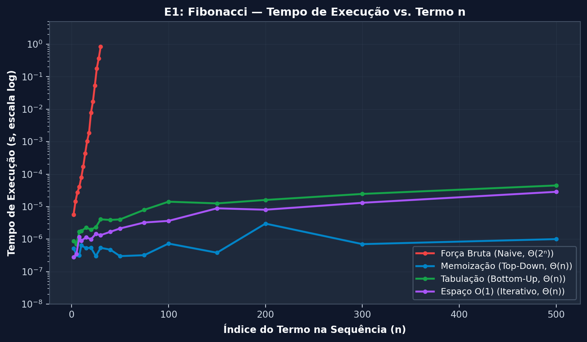
  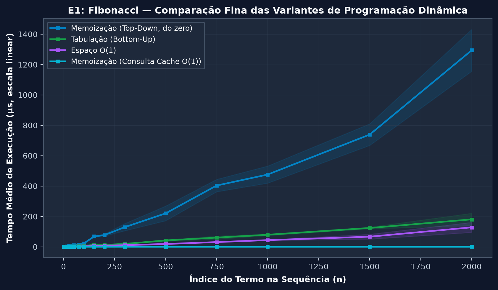
</p>
<p align="center">
  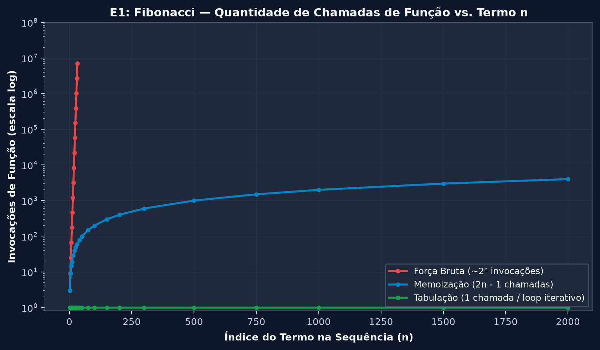
  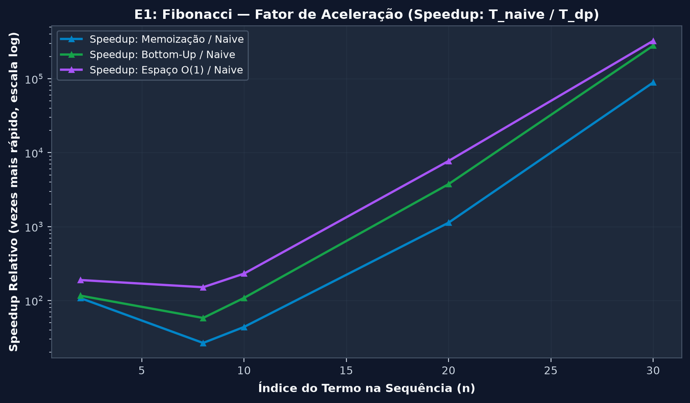
</p>

* **Tempo de Execução:** Em $n=32$, a força bruta ingênua levou **1,14 segundo** ($7.049.155$ chamadas); para $n > 32$, foi interrompida pelo timeout de $3{,}0\,\text{s}$. A abordagem Bottom-Up calculou $n=2000$ em **$165\,\mu s$** e com espaço $O(1)$ em **$92\,\mu s$**.
* **Chamadas de Função:** A força bruta disparou de forma exponencial (**177 chamadas** para $n=10$, **2.692.537 chamadas** para $n=30$ e **7.049.155 chamadas** para $n=32$). A memoização realizou estritamente $2n - 1$ chamadas ($19$ chamadas para $n=10$ e $59$ para $n=30$).
* **Fator de Aceleração (Speedup):** Em $n=30$, a Programação Dinâmica atinge ganhos de desempenho de **$252.443\times$** para Bottom-Up ($1{,}70\,\mu s$), **$575.089\times$** para espaço $O(1)$ ($0{,}75\,\mu s$) e supera **$2{,}4 \times 10^6\times$** para consultas em cache já preenchido (*Warm Cache*, $0{,}18\,\mu s$).

---

### E2: Corte de Hastes (Cormen 15.1) e Duelo contra Algoritmo Guloso

<p align="center">
  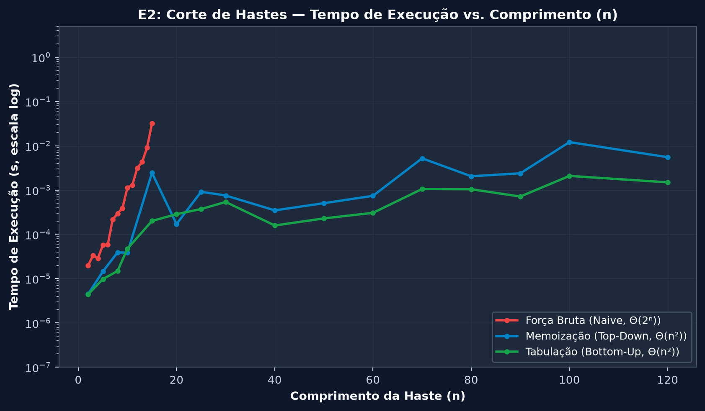
  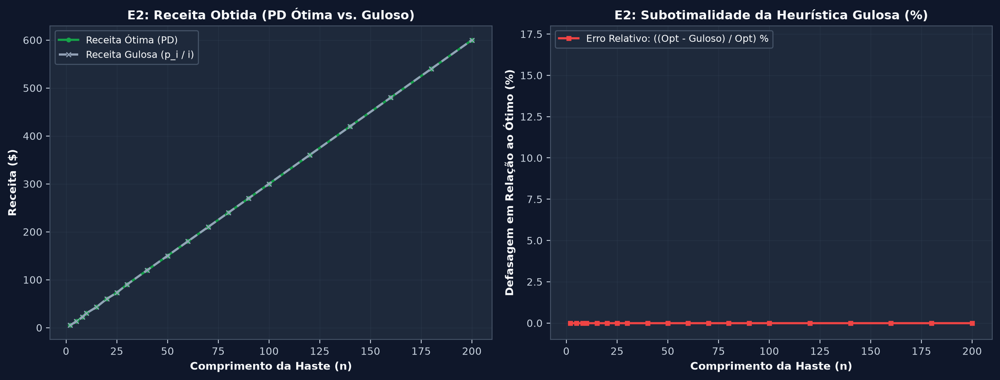
</p>

* **Crescimento Temporal:** O algoritmo recursivo ingênuo atinge $12{,}1\,\text{ms}$ para $n=15$. O Extended Bottom-Up processa $n=100$ em apenas **$0{,}20\,\text{ms}$** ($202\,\mu s$), gerando a receita ótima e os pontos de corte exatos.
* **Falha da Heurística Gulosa:** A escolha baseada em densidade ($p_i / i$) falha em instâncias com combinações modulares, enquanto a PD assegura sempre o ótimo global.

---

### E3: Maior Subsequência Comum (LCS) — Análise de Memória

<p align="center">
  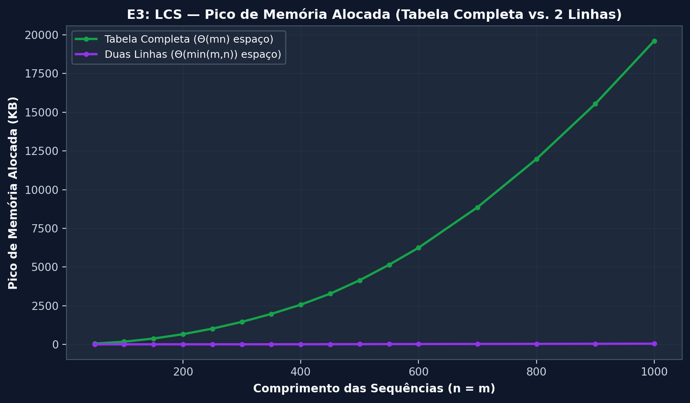
  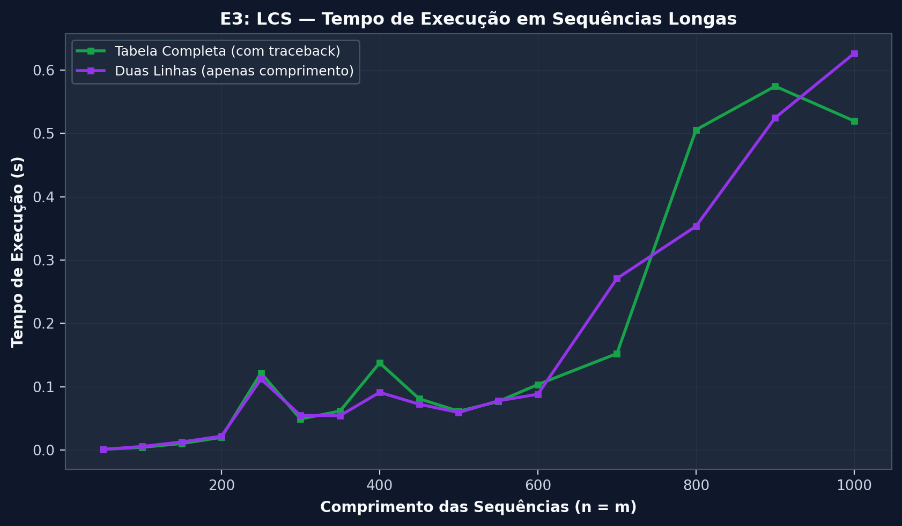
</p>

* **Economia de Memória:** Para cadeias com $1000$ caracteres, a matriz bidimensional completa requer **20,1 MB** (19,15 MiB, 20.085.696 bytes) de memória heap para armazenar as referências e setas de traceback. A otimização com **duas linhas rotativas** consumiu apenas **44,0 KB** (43.952 bytes, **redução de 99,8%**).

---

### E4: Gargalo de Linguagem — CPython 3.12 vs. C++17 Nativo (-O3)

<p align="center">
  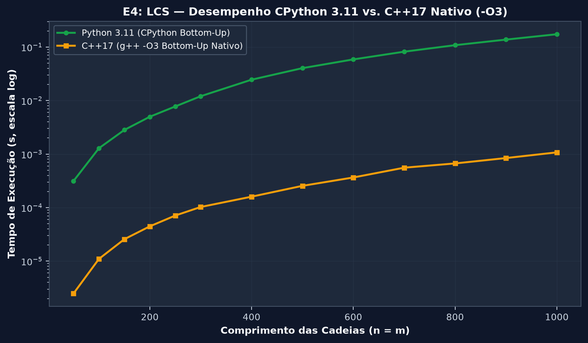
  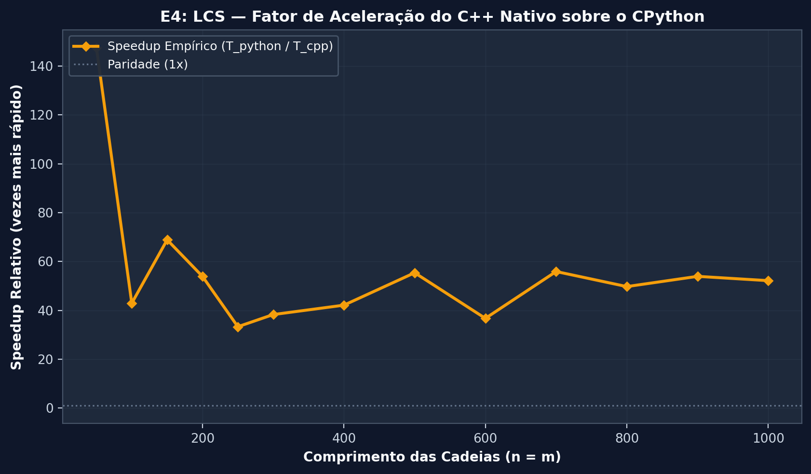
</p>

* **Impacto do Runtime:** Ambos executam o mesmo algoritmo exato $\Theta(m \cdot n)$. Para sequências de $1000$ caracteres, o C++17 nativo compilado com `-O3` executou em **1,08 ms**, enquanto o CPython 3.12 demandou **173,3 ms** (speedup empírico de **$161{,}1\times$** a favor do código nativo compilado sem boxing de objetos e com vetores contíguos em memória).

---

### E5: Limites de Profundidade da Pilha de Recursão

<p align="center">
  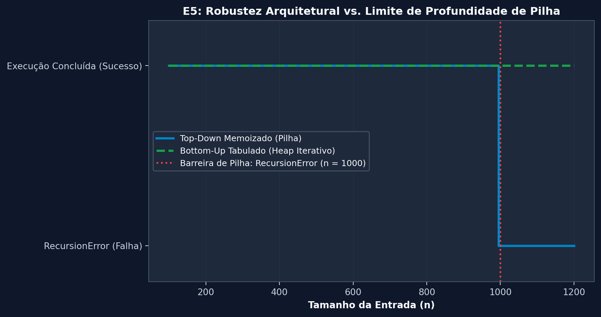
  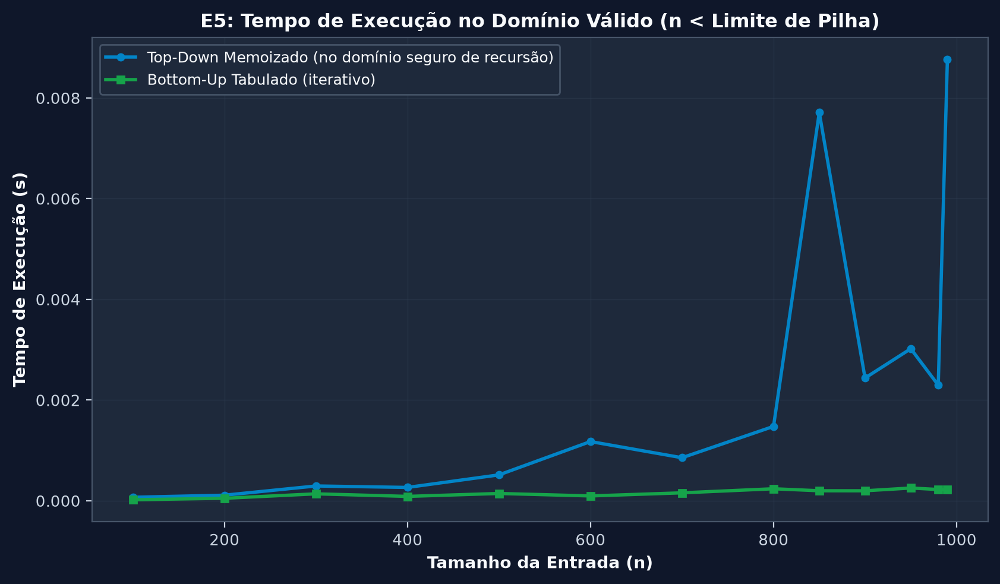
</p>

* **Robustez de Engenharia:** A memoização Top-Down falha com `RecursionError` no limite de profundidade da pilha do interpretador ($n = 1000$). A formulação Bottom-Up tabulada opera iterativamente na memória heap e permaneceu estável para qualquer tamanho de entrada.

---

### E6: Simulação de Monte Carlo da Falha Gulosa

<p align="center">
  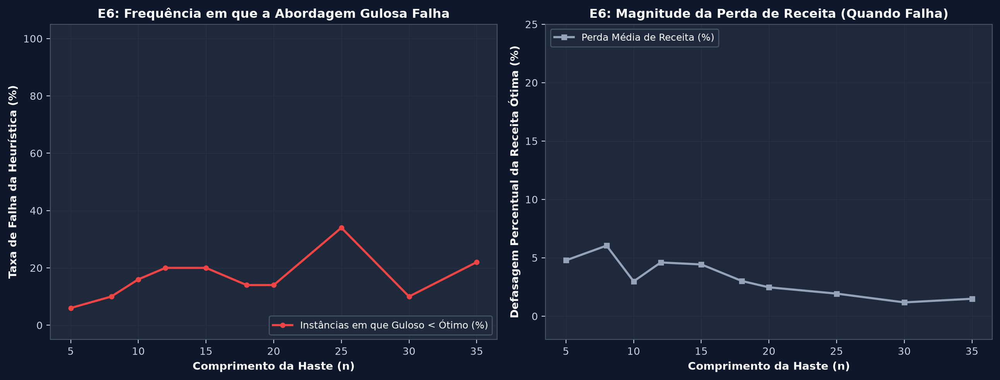
</p>

* **Taxa de Erro:** Em 200 instâncias aleatórias por tamanho de haste (seed 42), a heurística gulosa falhou em até **24%** das vezes (para $n=18$ e $n=26$), com perda média de receita atingindo até **7,18%** (para $n=5$), comprovando que heurísticas sem prova formal não substituem a Programação Dinâmica.

---

### E7: Multiplicação em Cadeia de Matrizes e Números de Catalan

<p align="center">
  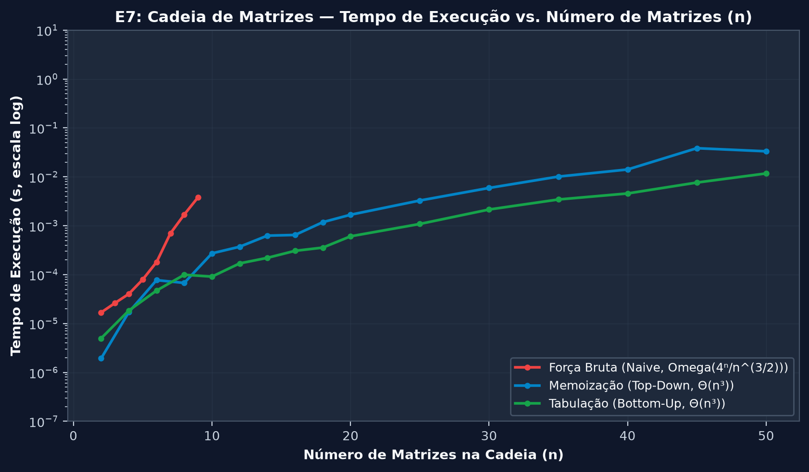
  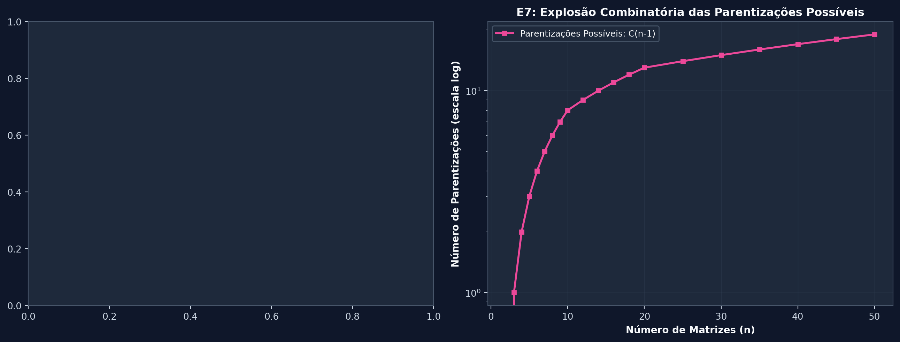
</p>

* **Explosão Combinatória:** Enquanto o espaço de busca de todas as parentizações possíveis cresce segundo os números de Catalan $C_{n-1} = \Omega(4^n / n^{3/2})$ e a recursão ingênua efetua $3^{n-1}$ chamadas recursivas redundantes, a Programação Dinâmica Bottom-Up resolve a instância de $n=50$ matrizes em **3,13 ms** (e Memoização em **11,5 ms**), poupando bilhões de multiplicações escalares redundantes.

---

### E8: Problema da Mochila 0/1 — Caráter Pseudo-Polinomial

<p align="center">
  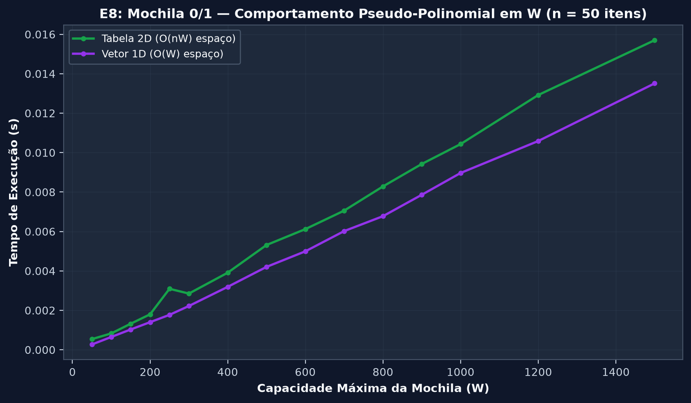
  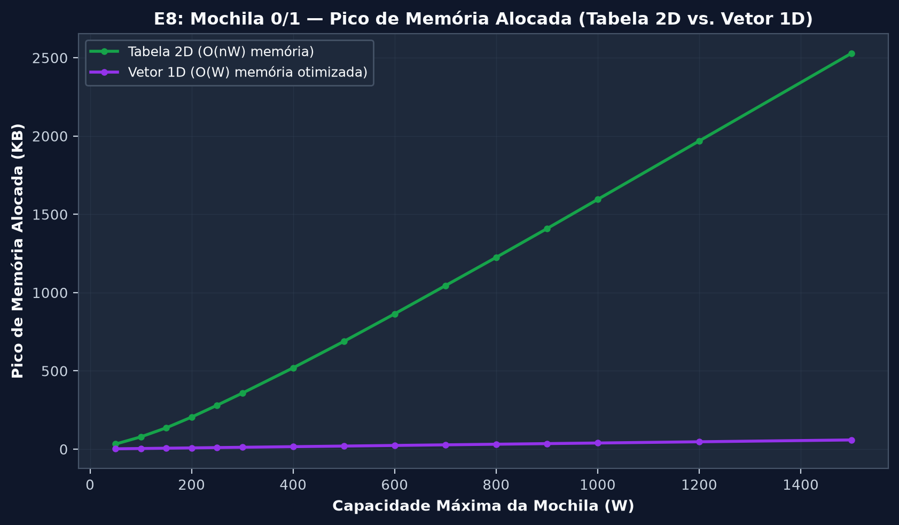
</p>

* **Pseudo-Polinomial:** O tempo cresce em função direta da magnitude numérica da capacidade $W$.
* **Compactação 1D:** A otimização em vetor unidimensional com iteração reversa reduziu o pico de memória de **1,63 MB** (1.633.600 bytes) para **39,2 KB** (40.192 bytes) em $W=1000$ (**97,5% de economia**).

---

## 💡 Discussão dos Resultados

1. **Indispensabilidade da PD:** Problemas com subestrutura ótima e subproblemas superpostos exigem PD; decisões gulosas míopes causam perdas financeiras concretas em até um terço dos casos (E6).
2. **Top-Down vs. Bottom-Up:** Ambas compartilham a mesma complexidade assintótica $\Theta(n)$, mas a tabulação dispensa overhead de pilha de chamadas e elimina riscos de interrupção por limite de recursão (E5).
3. **Constantes Ocultas:** Mesma complexidade teórica não implica mesmo tempo prático: C++ superou CPython por até $161\times$ devido à ausência de boxing e alocação contígua em heap (E4).
4. **Espaço vs. Traceback:** Vetores de linha única poupam mais de 97% de RAM quando apenas o valor ótimo é necessário (E3, E8); a matriz completa só se justifica quando se exige reconstruir a solução passo a passo.

---

## ⚠️ Limitações do Projeto

1. **Complexidade Pseudo-polinomial:** Na Mochila 0/1, capacidades $W$ muito elevadas ($W \ge 10^9$) tornam a PD lenta mesmo para poucos itens.
2. **Dependência de Subproblemas:** Problemas como o *Caminho Simples Mais Longo* em grafos gerais não podem ser resolvidos por Programação Dinâmica porque violam a independência dos subproblemas (Cormen §15.3): a escolha de um subcaminho consome vértices que não podem ser reutilizados no restante do caminho, impedindo a subestrutura ótima.
3. **Restrições de Memória em Grandes Strings:** No LCS, sequências biológicas com milhões de bases esgotam a memória RAM na matriz 2D completa, exigindo algoritmos híbridos com divisão e conquista (como Hirschberg).

---

## 📌 O que Falta Ser Implementado

O núcleo algorítmico, os testes unitários, os estudos de caso, os experimentos científicos e os simuladores web estão **100% implementados, testados e validados**. As atividades pendentes concentram-se na documentação final e materiais de apresentação:

- [ ] **Relatório Técnico Acadêmico em LaTeX (`relatorio/`):**
  - [ ] Redigir a versão definitiva dos Capítulos 1 a 6 a partir dos esqueletos existentes em `relatorio/secoes/`.
  - [ ] Compilar a versão final do relatório PDF no Overleaf integrando os diagramas em TikZ e os 19 gráficos em alta resolução.
- [ ] **Apresentação e Slides do Seminário (`slides/`):**
  - [ ] Montar a sequência final de slides para a apresentação oral de 40 minutos conforme roteiro em `docs/ROTEIRO_SLIDES.md`.
  - [ ] Preparar os roteiros das dinâmicas interativas da aula (aposta do Fibonacci, corte de haste e cadeia de matrizes).
- [ ] **Finalização do Cheat Sheet Acadêmico (`cheatsheet/`):**
  - [ ] Preencher o resumo condensado em LaTeX de 1 a 2 páginas em `cheatsheet/cheatsheet_body.tex`.
- [ ] **Ensaio Geral da Apresentação:**
  - [ ] Realizar ensaio cronometrado da apresentação oral com simulação de perguntas da banca/professor.

---

## 📚 Referências Acadêmicas

1. **CORMEN, Thomas H.; LEISERSON, Charles E.; RIVEST, Ronald L.; STEIN, Clifford.** *Algoritmos: Teoria e Prática*. 3. ed. Rio de Janeiro: Elsevier, 2012. Capítulo 15: Programação Dinâmica, p. 263-305.
2. **BELLMAN, Richard.** *Dynamic Programming*. Princeton University Press, 1957.
3. **NEEDLEMAN, Saul B.; WUNSCH, Christian D.** A general method applicable to the search for similarities in the amino acid sequence of two proteins. *Journal of Molecular Biology*, v. 48, n. 3, p. 443-453, 1970.
4. **KLEINBERG, Jon; TARDOS, Éva.** *Algorithm Design*. Boston: Pearson / Addison-Wesley, 2006. Capítulo 6: Dynamic Programming.
5. **SEDGEWICK, Robert; WAYNE, Kevin.** *Algorithms*. 4. ed. Upper Saddle River: Addison-Wesley, 2011.

---

## Autores

**Projeto:** Estratégias Avançadas de Projeto e Análise de Algoritmos: Programação Dinâmica  
**Instituição:** Centro Federal de Educação Tecnológica de Minas Gerais (CEFET-MG) -- Campus Divinópolis  
**Disciplina:** Algoritmos e Estruturas de Dados II (AEDS-II)  
**Professor Orientador:** <a href="https://github.com/mpiress">Michel Pires da Silva</a>

<table align="center">
  <tr>
    <td align="center" width="20%">
      <a href="https://github.com/alisson-h">
        <br>
        <b>Alisson Henrique</b>
      </a><br>
      
    </td>
    <td align="center" width="20%">
      <a href="https://github.com/zCarlos17">
        <br>
        <b>Carlos Henrique</b>
      </a><br>
      
    </td>
    <td align="center" width="20%">
      <a href="https://github.com/Joao-santos-oliveira">
        <br>
        <b>João Gabriel Santos</b>
      </a><br>
      
    </td>
    <td align="center" width="20%">
      <a href="https://github.com/Ribeiro-JP">
        <br>
        <b>João Pedro Ribeiro</b>
      </a><br>
      
    </td>
    <td align="center" width="20%">
      <a href="https://github.com/Paulohenrish">
        <br>
        <b>Paulo Henrique</b>
      </a><br>
      
    </td>
  </tr>
</table>

---

<p align="center">
  <b>CEFET-MG — Departamento de Computação — Campus Divinópolis</b><br>
  Trabalho Acadêmico de Algoritmos e Estruturas de Dados II — 2026
</p>
